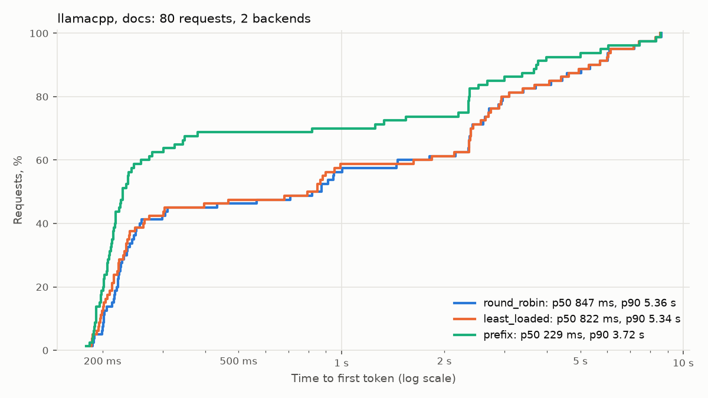
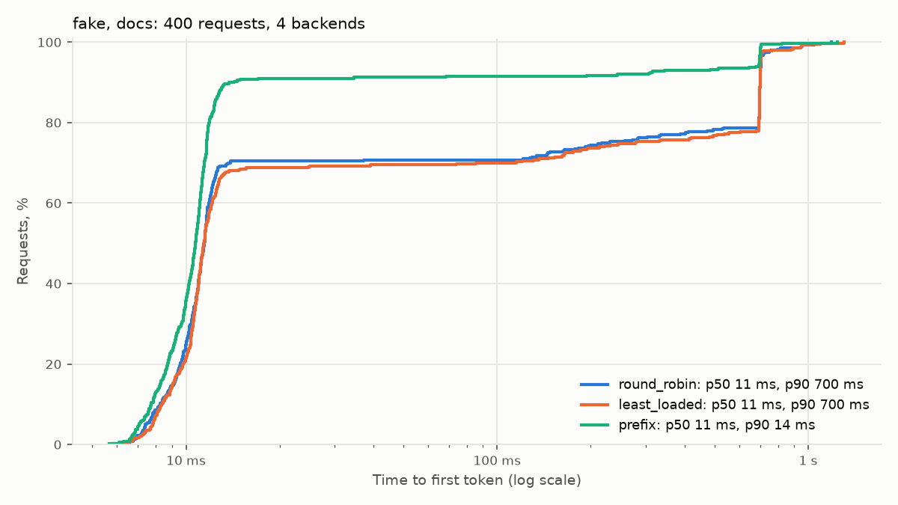
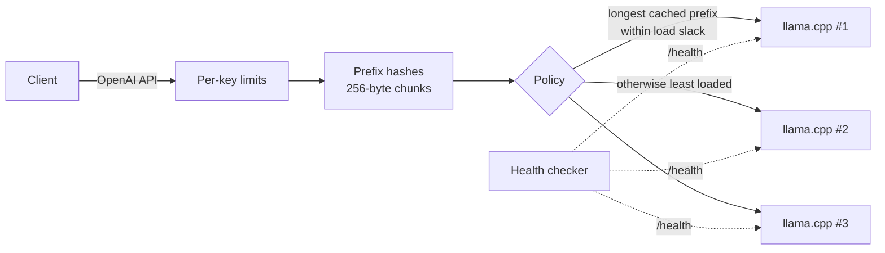

# llm-router

[](https://github.com/NikkiRe/llm-router/actions/workflows/ci.yml)

A cache-aware load balancer for OpenAI-compatible LLM servers (llama.cpp, vLLM),
written in Go.

LLM servers keep the KV cache of prompts they have already processed, so a request
that starts like an earlier one skips most of its prefill. An ordinary load balancer
scatters requests that share a prefix (a system prompt, a document, a chat history)
across instances, and each instance computes that prefix again. llm-router remembers
which prefixes it sent where and routes each request to the instance most likely to
hold its prefix, without letting one instance take all the load.

## Results

**Two llama.cpp servers with Qwen3-8B (Q4_K_M)** on one Apple M4 Pro: 2 slots each,
1 GiB host prompt cache each, 80 questions about 12 documents of about 950 tokens at
0.4 requests/s. Twelve documents do not fit one server's cache but fit both together,
which is the case cache-aware routing is for.



| Policy | TTFT p50 | TTFT p90 | TTFT p99 | Latency p50 | Prompt tokens from cache | Requests per backend |
| --- | --- | --- | --- | --- | --- | --- |
| round_robin | 847 ms | 5.36 s | 8.39 s | 1.81 s | 64% | 41, 39 |
| least_loaded | 822 ms | 5.34 s | 8.35 s | 1.85 s | 64% | 41, 39 |
| **prefix** | **229 ms** | **3.72 s** | 8.38 s | **713 ms** | **75%** | 44, 36 |

Prefix routing cut median time to first token 3.7 times and median latency 2.5 times
against round robin, with load still even. The p99 did not move: it is the first
request for a document, which no policy can serve from cache, waiting behind other
prefills on the shared GPU. One prompt of 980 tokens takes 2.96 s to prefill cold and
23 ms from cache on this machine. With 80 requests the tail percentiles are rough.

**Simulated backends.** Four [fakellm](internal/fakellm) servers with a KV prefix
cache, 4 slots each, 4,000 prompt tokens/s prefill and 50 tokens/s decode. Every
policy gets the same seeded open-loop workload, and backends restart before each run.



| Workload | Policy | TTFT p50 | TTFT p90 | TTFT p99 | Prompt tokens from cache | Requests per backend |
| --- | --- | --- | --- | --- | --- | --- |
| 400 questions about 16 documents (Zipf), 4 req/s | round_robin | 11 ms | 700 ms | 954 ms | 78% | 100, 100, 100, 100 |
| | least_loaded | 11 ms | 700 ms | 954 ms | 77% | 101, 98, 100, 101 |
| | **prefix** | 11 ms | **14 ms** | **704 ms** | **93%** | 85, 138, 75, 102 |
| 60 chats × 6 turns, shared system prompt | round_robin | 174 ms | 347 ms | 478 ms | 54% | 90, 90, 90, 90 |
| | least_loaded | 174 ms | 354 ms | 479 ms | 53% | 91, 89, 90, 90 |
| | **prefix** | **91 ms** | **95 ms** | **238 ms** | **79%** | 156, 119, 77, 8 |

Prefix routing trades even load for cache hits: under light load it keeps traffic on
the backends that already hold the prefix, within `load_slack` extra requests of the
least loaded one. In the chat run the fourth backend was rarely needed. Full tables:
[docs](bench/results/fake-docs/summary.md), [chat](bench/results/fake-chat/summary.md).

## How it works



1. The prompt is cut into 256-byte chunks; each chunk's hash covers the whole prefix
   before it, so equal hash *i* means equal first *i* chunks.
2. Each backend has an LRU set of the hashes recently sent to it, sized like its KV
   cache. Shared starts of prompts are kept longest.
3. The `prefix` policy picks the backend holding the longest prefix of the request,
   among backends running at most `load_slack` more requests than the least loaded
   one. If less than `min_match_ratio` of the prompt is cached anywhere, the request
   goes to the least loaded backend.
4. Each backend takes at most `max_inflight` requests (its slot count). When all are
   full, requests wait in the router and get `503` with `Retry-After` after
   `queue_timeout`.

Also: SSE streaming with flush per event, retries on another backend until the first
byte is sent, active and passive health checks with fall/rise thresholds,
cancellation of generation when the client disconnects, per-API-key token-bucket and
concurrency limits, Prometheus metrics and pprof.

Design notes and the reasoning behind each decision (in Russian):
[docs/DESIGN.md](docs/DESIGN.md).

## Quick start

```bash
make build
for p in 8081 8082 8083; do ./bin/fakellm -addr 127.0.0.1:$p -name f$p & done
./bin/llmrouter -config config.example.yaml

curl -N localhost:8080/v1/chat/completions -H 'Content-Type: application/json' \
  -d '{"stream":true,"messages":[{"role":"user","content":"Hello"}]}'
curl localhost:9090/backends
curl -s localhost:9090/metrics | grep llmrouter_
```

`fakellm` is a simulated server with a KV prefix cache for running without a GPU. For
llama.cpp, start `llama-server -m model.gguf --port 8081 -np 4` per instance and set
`max_inflight` to the same `-np`. The docker demo starts three simulated backends and
Prometheus: `make demo`.

Configuration with every option explained: [config.example.yaml](config.example.yaml).

## Metrics

| Metric | Meaning |
| --- | --- |
| `llmrouter_time_to_first_token_seconds` | From request to the first generated token |
| `llmrouter_request_duration_seconds` | From request to the end of the response |
| `llmrouter_prefix_match_ratio` | Share of the prompt the chosen backend was believed to have cached |
| `llmrouter_routing_decisions_total{reason}` | `prefix`, `least_loaded` or `round_robin` |
| `llmrouter_tokens_total{kind}` | Prompt, cached and completion tokens from backend usage |
| `llmrouter_rejected_total{reason}` | Rate limit, queue timeout, no backend, client gone |
| `llmrouter_backend_inflight`, `llmrouter_backend_healthy` | Per-backend state |

## Benchmark

`bench/` sends the same seeded workload through the router once per policy and
restarts the backends before each run, so no policy inherits a warm cache. Requests
arrive open loop (Poisson), so a slow policy builds a queue instead of slowing the
load down.

```bash
make bench-fake                                   # simulated backends
make bench-llamacpp MODEL=path/to/model.gguf      # two llama.cpp servers
```

## Layout

| Path | Contents |
| --- | --- |
| `cmd/llmrouter` | Router binary, admin endpoints, graceful shutdown |
| `cmd/fakellm` | Simulated backend binary |
| `internal/prefix` | Prefix chunk hashes and per-backend LRU index |
| `internal/balancer` | Backend pool, admission, health state, routing policies |
| `internal/proxy` | OpenAI-compatible handler, SSE relay, retries |
| `internal/limit` | Per-key token bucket and concurrency limits |
| `internal/health` | Active health checks |
| `internal/fakellm` | Simulated server with a KV cache cost model |
| `bench/` | Python benchmark (uv, httpx, matplotlib) |

## Limitations

- The router predicts each backend's cache from what it routed there; it does not see
  the real cache. Subscribing to KV cache events from the server would remove the guess.
- One router replica: several replicas would each see only their own traffic.
- Limits count requests, not tokens; there are no request priorities.
