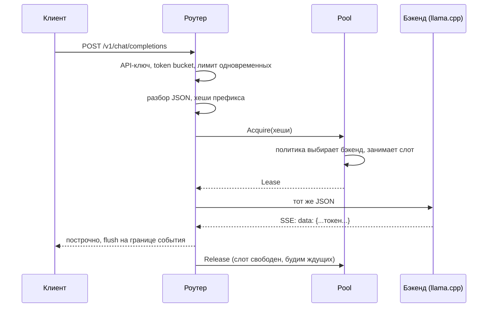

# Как устроен llm-router и почему именно так

Документ для того, кто будет защищать проект на собеседовании: что делает каждая часть,
какие решения приняты и что на них можно ответить.

## Задача

Генерация в LLM состоит из двух фаз. **Prefill** прогоняет весь промпт через модель и
заполняет KV-кеш; это дорого и растёт с длиной промпта. **Decode** выдаёт токены по одному.
Время до первого токена (TTFT) почти целиком состоит из prefill.

Серверы вроде llama.cpp и vLLM хранят KV-кеш уже посчитанных префиксов. Если новый запрос
начинается так же, как предыдущий (тот же системный промпт, тот же документ, та же история
чата), сервер пересчитывает только новую часть. Но кеш у каждого инстанса свой. Обычный
балансировщик (round robin, least connections) раскидывает запросы с общим префиксом по
разным инстансам, и каждый считает префикс заново.

Роутер помнит, какие префиксы куда отправлял, и посылает запрос туда, где его начало
скорее всего уже в кеше, но не ценой перегрузки одного сервера.

## Путь запроса

Код: [proxy.go](../internal/proxy/proxy.go) → [balancer.go](../internal/balancer/balancer.go) →
[policy.go](../internal/balancer/policy.go).

## Решения

**1. Хеши префикса цепочкой.** Промпт режется на куски по `chunk_size` байт, хеш i-го куска
считается по всему префиксу до него включительно (потоковый FNV-1a,
[prefix.go](../internal/prefix/prefix.go)). Поэтому совпадение i-го хеша значит совпадение
всего префикса, и не нужно хранить дерево: достаточно множества хешей.

**2. Байты, а не токены.** Роутер не знает токенизатор модели и не должен: одинаковые байты
дают одинаковые токены. На границе куска токенизация может разойтись, поэтому неполный
последний кусок отбрасывается. 256 байт — примерно 64 токена.

**3. LRU на каждый бэкенд как модель его KV-кеша.** Ёмкость (`cache_chunks`) примерно равна
размеру кеша сервера. При вставке хеши обходятся с конца, чтобы начала промптов оказались
самыми свежими: при вытеснении первыми уходят хвосты, а общий системный промпт живёт дольше.
Так же вытесняют блоки vLLM и SGLang (листья радиксного дерева раньше корня).

**4. Ограничение дисбаланса (`load_slack`).** Если гнаться только за кешем, популярный
документ соберёт всю нагрузку на одном сервере. Бэкенд с кешем выбирается, только если у
него не больше чем на `load_slack` запросов больше, чем у самого свободного. Это идея
consistent hashing with bounded loads (Mirrokni и др., 2016), перенесённая на кеш.

**4а. При равном совпадении побеждает менее загруженный.** Эту ошибку нашёл бенчмарк, а
не юнит-тесты. В сценарии с чатами у всех сессий общий системный промпт. Когда он
закеширован на нескольких бэкендах, совпадение у них одинаковое, и первая версия политики
отдавала ничью первому бэкенду в конфиге: 304 запроса из 360 ушли на один сервер, хотя
TTFT при этом даже улучшился. Теперь среди равных выбирается менее загруженный, а обход
начинается со сдвига, чтобы полные ничьи не доставались одному и тому же серверу. Заодно
`load_slack` по умолчанию уменьшен с 4 до 2: при четырёх слотах на сервер ограничение
в 4 не срабатывало никогда. Тест: `TestPrefixAwareSpreadsSharedPrefixByLoad`.

**5. Минимальная доля совпадения (`min_match_ratio`).** Короткий общий системный промпт в
начале длинных разных запросов не должен привязывать всё к одному серверу. Следуем за кешем,
только если закешировано не меньше половины промпта; иначе — least loaded.

**6. Очередь в роутере, а не на сервере.** `max_inflight` равен числу слотов сервера
(`llama-server -np`). Когда все заняты, запрос ждёт в роутере. Плюс: пока он ждёт, роутер
может отдать его серверу, который освободился первым. По таймауту — 503 и `Retry-After`,
это backpressure: клиент узнаёт о перегрузке сразу, а не через минуту.

**7. Канал `wake` вместо `sync.Cond`.** Ждать нужно с отменой по `context` (клиент ушёл,
вышел таймаут), а `sync.Cond` так не умеет. Канал закрывается и заменяется новым при каждом
освобождении слота или смене здоровья — все ждущие просыпаются и пробуют снова.

**8. Ретраи только до первого байта ответа.** Если сервер не ответил или ответил 502/503/504,
запрос уходит на другой сервер. После того как клиент получил хоть один токен, повторить
нельзя — ответ был бы склеен из двух генераций.

**9. Здоровье: активные и пассивные проверки.** Раз в `interval` роутер дёргает `/health`
(llama.cpp отвечает 503, пока грузит модель). Ошибки обычных запросов тоже считаются.
Пороги `fall`/`rise` — как в HAProxy, чтобы один таймаут не выкидывал сервер. Когда сервер
возвращается, его индекс префиксов очищается: после рестарта кеш пуст.

**10. Обрыв клиента останавливает генерацию.** Запрос к бэкенду создаётся с контекстом
клиентского запроса. Клиент закрыл соединение → контекст отменён → соединение с бэкендом
закрыто → llama.cpp прекращает генерацию и освобождает слот. Иначе GPU работал бы впустую.

**11. TTFT по первому событию с токеном.** Сервер может открыть стрим событием, где есть
только `role`. Если считать по нему, TTFT выйдет около нуля. Роутер парсит первые события,
пока не встретит текст.

**12. Token bucket своими руками.** ~40 строк ([limit.go](../internal/limit/limit.go)),
часы подменяются в тестах, поэтому тесты детерминированы. Лимит одновременных запросов
проверяется до bucket, чтобы отказ по нему не сжигал токен. Ключи без запросов дольше
10 минут удаляются, чтобы карта не росла бесконечно.

**13. fakellm для тестов и CI.** Модель стоимости: prefill незакешированной части идёт
по одному запросу за раз (он упирается в вычисления), decode — параллельно по слотам.
Это грубо: на настоящем GPU prefill батчится, а decode замедляется с ростом батча. Поэтому
есть и прогон на настоящей модели через llama.cpp.

## Метрики

`/metrics` на admin-порту: запросы по бэкенду и коду, длительность, TTFT, решения роутинга
по причине, доля промпта в кеше выбранного бэкенда, токены из usage (prompt, cached,
completion), отказы по причине, ретраи, а также in-flight и здоровье каждого бэкенда.
`/backends` — состояние пула в JSON, `/debug/pprof` — профилирование.

## Вопросы, которые могут задать

**Почему не consistent hashing по префиксу?** Он даёт привязку, но не знает про нагрузку
и не умеет «частичных» совпадений: запрос с тем же документом, но другим вопросом, — другой
ключ. Здесь совпадение считается по длине общего начала, и нагрузка ограничена явно.

**Роутер же не видит настоящий кеш сервера?** Да, это предсказание: «что я туда отправлял
недавно, скорее всего ещё в кеше». Ошибается, когда сервер вытеснил блоки раньше, чем думает
роутер. Точнее — подписаться на события KV-кеша от сервера (так делают vLLM и llm-d); это
следующий шаг.

**Что будет с несколькими репликами роутера?** Каждая видит только свои запросы, и
привязка размывается. Варианты: sticky-маршрутизация клиентов к репликам роутера, общий
индекс (Redis) или те же события KV-кеша от серверов.

**Почему Go?** Тысячи долгих стримов — это горутина на соединение без сложной асинхронщины,
`context` для отмены по всей цепочке, стандартный `net/http` с `ResponseController` для
flush.

**Сложность выбора бэкенда?** O(N·K) на запрос: N бэкендов, K кусков промпта, каждый шаг —
поиск в хеш-таблице. Промпт в 11,6 КБ (45 кусков) проверяется на одном бэкенде за 0,4 мкс
на M4 Pro (`go test -bench . ./internal/prefix`), что ничтожно рядом с prefill.

## Ограничения

- Индекс приблизительный, см. выше.
- Одна реплика роутера.
- Лимиты считают запросы, а не токены.
- Нет приоритетов запросов.
